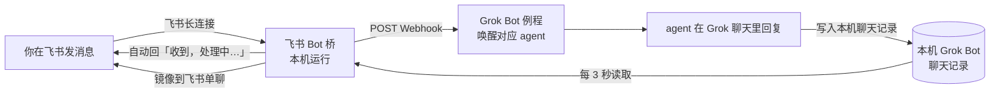

# 完整设置指南

目标：拿到这个项目后，照着做就能把一个（或多个）Grok Bot agent 接到飞书，实现双向同步。每个 agent 一套，第一个大约 15 分钟，后面每个 5 分钟。

先看清楚整体是怎么流转的：



要点：agent **不直接往飞书发消息**。它只在 Grok 聊天里回复，由桥把 Grok 聊天原样镜像到飞书。所以飞书里看到的，和 Grok 里看到的一模一样。

## 0. 准备

- 一个飞书账号，并且有权限在 [飞书开放平台](https://open.feishu.cn/app) 创建企业自建应用（个人版飞书也可以建自己企业下的应用）。
- Grok Bot 桌面端已安装、已登录，要接入的 agent 都在这台电脑上。
- 在**同一台电脑**上安装飞书 Bot 桥（见 [README](../README.md#下载安装)）。

建议先准备一个表格，每个 agent 一行，记下面这些值，后面会逐个填进桥里：

| 字段 | 从哪里来 | 示例格式 |
|---|---|---|
| 名称 | 你自己起，建议和飞书机器人名一致 | `AI 学习` |
| App ID | 飞书开放平台 → 凭证与基础信息 | `cli_a1b2c3...` |
| App Secret | 同上 | 32 位字符串（保密） |
| Webhook URL | Grok Bot 例程面板 | `https://...` |
| Webhook Key | Grok Bot 例程面板 | 字符串（保密） |
| 主人 open_id | 第一次收到消息后从日志/负载里拿 | `ou_xxx` |
| Grok agent_id | Grok Bot 里这个 agent 的 id | UUID |
| 飞书单聊 chat_id | 第一次收到消息后从负载里拿 | `oc_xxx` |

## 1. 在飞书开放平台创建机器人（每个 agent 一个）

1. 打开 [飞书开放平台 → 开发者后台](https://open.feishu.cn/app)，点「创建企业自建应用」。名称和头像就是飞书里机器人的名字和头像，建议和 agent 同名，每个用不同头像方便区分。
2. 左侧「添加应用能力」→ 添加「**机器人**」。
3. 左侧「**权限管理**」→ 开通以下权限（可在搜索框里按权限名搜）：

   | 权限 | 用途 | 必需？ |
   |---|---|---|
   | `im:message`（获取与发送单聊、群组消息） | 基础消息能力 | 必需 |
   | `im:message:send_as_bot`（以应用的身份发消息） | 自动回复、镜像 Grok 聊天 | 必需 |
   | `im:message.p2p_msg:readonly`（读取用户发给机器人的单聊消息） | 接收单聊 | 必需 |
   | `im:message.group_at_msg:readonly`（接收群聊中 @ 机器人消息事件） | 群里 @ 它时接收 | 需要群聊时 |
   | `im:message.group_msg`（获取群组中所有消息） | 「群聊接收全部消息」模式 | 只给群分诊机器人 |

4. 左侧「**事件与回调**」：
   - 「事件配置」→ 订阅方式选「**使用长连接接收事件**」→ 添加事件 `im.message.receive_v1`（接收消息）。
   - 「回调配置」→ 订阅方式同样选「**使用长连接接收回调**」→ 添加回调 `card.action.trigger`（卡片回传交互）。这一步是飞书里点选择卡片按钮能回传的前提。

   > 保存长连接方式时，飞书会检查是否有客户端在线。如果提示「未检测到应用连接」，先跳到第 3 节把 App ID / Secret 填进桥并启用，再回来保存。

5. 左侧「凭证与基础信息」→ 复制 **App ID** 和 **App Secret**。
6. 左侧「版本管理与发布」→ 创建版本 → 申请发布。**每次改了权限、事件或回调，都要重新发一个版本才生效。** 企业管理员审核通过后，在飞书里搜索机器人名称就能找到它并开始单聊。
7. （可选）想让所有机器人在一个群里：建一个群，在群设置 →「群机器人」里把各个机器人加进去。

## 2. 在 Grok Bot 里给 agent 建一个 Webhook 例程

飞书消息要能唤醒 agent，agent 需要一个「Webhook 触发」的例程（routine）。

1. 在 Grok Bot 里打开这个 agent 的聊天，直接对它说：

   > 帮我建一个 Webhook 触发的例程，叫「飞书消息 → <agent 名称>」，提示词用这个：（粘贴 [examples/routine-prompt.md](../examples/routine-prompt.md) 里的模板，把里面的名称换成这个 agent）

   agent 会创建例程，界面上会弹出确认卡片，点确认。
2. 在例程面板里复制 **Webhook URL** 和 **Webhook Key**（发送密钥）。这两个值只放进飞书 Bot 桥，不要发到聊天里，也不要提交到任何仓库。
3. 拿到 **agent_id**：直接问这个 agent「你的 agent id 是多少？」，它能从自己的配置文件读出来（一个 UUID）。

桥发给 Webhook 的请求格式（例程提示词里会用到）：

```json
{
  "chat_id": "oc_xxx",
  "message_id": "om_xxx",
  "chat_type": "p2p",
  "sender_open_id": "ou_xxx",
  "text": "飞书里发来的原文",
  "bot_slug": "ai-xuexi",
  "bot_name": "AI 学习"
}
```

可能额外出现的字段：

- `group_all: true`：群里一条没有 @ 任何机器人的消息，只会发给开了「群聊接收全部消息」的那个机器人。
- `card_action: true` 和 `widget_prompt`：你在飞书里点了选择卡片的按钮，`text` 是你选的选项，`widget_prompt` 是原来的问题。
- `test: true`：桥界面里点「测试 Webhook」发出的测试消息，agent 应该忽略。

请求头带 `Authorization: Bearer <Webhook Key>`。

## 3. 在飞书 Bot 桥里添加机器人

1. 启动飞书 Bot 桥，会打开管理窗口（也可以用浏览器访问 `http://127.0.0.1:8765/`）。
2. 点「＋ 新增机器人」，填写：

   | 界面字段 | 填什么 |
   |---|---|
   | 名称 | 飞书里机器人的名字（群聊里按名字判断是否被 @，务必和飞书一致） |
   | App ID | 第 1 节拿到的 `cli_...` |
   | App Secret | 第 1 节拿到的密钥 |
   | Webhook URL | 第 2 节例程面板里的 URL |
   | Webhook Key | 第 2 节例程面板里的 Key |
   | 主人 open_id（可选） | 先留空，第 4 节拿到后再填。填了以后只处理这些人的消息，多个用英文逗号分隔 |
   | 机器人 open_id | 留空，启动后自动获取 |
   | Grok agent_id | 第 2 节拿到的 agent id |
   | 飞书单聊 chat_id | 先留空，第 4 节拿到后再填 |

3. 点「保存」，再点「**测试 Webhook**」。看到 `HTTP 200 ✅` 说明桥能唤醒这个 agent（agent 会收到一条带 `test: true` 的测试消息并忽略它）。
4. 打开「**启用**」开关。卡片状态变成已连接、日志出现「websocket 连接中…」且没有报错，就说明飞书长连接已建立。此时回到飞书开放平台保存第 1 节第 4 步的长连接设置。

> 批量导入命令：`curl -s -X POST http://127.0.0.1:8765/api/import-json -H "Content-Type: application/json" --data @bots.json`
>
> 已经有一批机器人？「设置 → 导入」支持从旧版 `feishu-bridge` 目录导入，或者调用 `POST /api/import-json` 批量导入，格式见 [examples/bots.example.json](../examples/bots.example.json)。导入的机器人默认都是未启用状态，检查无误后逐个打开。

## 4. 发第一条消息，拿到 open_id 和 chat_id

1. 在飞书里找到这个机器人，单聊发一句「你好」。
2. 飞书里应该立刻收到「收到，处理中…」；桥的日志出现「已转发 om_... (p2p)」。
3. Grok 里这个 agent 会被唤醒。例程收到的负载里有 `chat_id`（`oc_` 开头，就是你和机器人的单聊）和 `sender_open_id`（`ou_` 开头，就是你的 open_id）。直接问 agent「刚才飞书消息里的 chat_id 和 sender_open_id 是什么？」即可。
4. 回到桥里编辑这个机器人：
   - 「飞书单聊 chat_id」填 `oc_...`
   - 「主人 open_id」填 `ou_...`（强烈建议填，防止别人给你的机器人发消息唤醒 agent）
   - 打开「**聊天同步**」，保存。

聊天同步第一次开启时从当前最新一条开始，不会把历史记录全部补发。

## 5. 验证双向同步

在飞书里再发一句话，应该依次看到：

1. 飞书里立刻出现「收到，处理中…」。
2. Grok 里 agent 被唤醒并回复。
3. 几秒后，agent 的回复以卡片形式出现在飞书单聊里。

在 Grok 里直接给这个 agent 打字，你的消息会以标题「haohao」的浅蓝色卡片出现在飞书里（标题取自代码里的固定文字，可在 `app/core.py` 的 `ChatSync._tick` 里改成你的名字），agent 的回复跟在后面。

镜像规则：

| Grok 里的内容 | 飞书里的样子 |
|---|---|
| 你亲手输入的消息 | 浅蓝色卡片，标题是你的名字 |
| agent 发给你的可见回复 | 无标题 Markdown 卡片（链接、加粗、列表、代码都能显示） |
| 选择题（多选项） | 蓝色按钮卡片，点按钮后变绿色「已选择」，选项回传给 agent |
| 别的 agent 发来的消息 | 紫色卡片，标题是对方 agent 名 |
| 这个 agent 发给别的 agent 的消息 | 灰色标题卡片「→ 对方名」 |
| 系统提示、例程唤醒、后台任务等隐藏内容 | 不同步 |

**例程回复约定**：例程被唤醒后，agent 在 Grok 里发两条消息：第一条 `飞书（机器人名）：原文`，第二条是回复正文且**不要以「飞书」开头**。桥会跳过第一条（避免把你的原话再发回飞书），只同步回复正文。模板已经写好这一点。

## 6. 开机自启

「设置」里打开「开机自启」，登录系统后桥会以托盘最小化方式启动，并自动连接所有已启用的机器人。关闭窗口只是缩到托盘，从托盘菜单退出才会真正停止。

## 7. 多个 agent、多台电脑

- 每个 agent 重复第 1–4 节：一个飞书应用 + 一个 Webhook 例程 + 桥里一条机器人配置。
- 一台电脑只能同步**它自己**登录的 Grok Bot 里的 agent 聊天记录。如果 agent 分布在不同电脑上，每台都装一个桥，各自只配置本机的 agent。
- 同一个飞书应用不要同时在两台电脑的桥里启用，否则消息会被两边各收一次。

## 8. 数据存放位置

| 系统 | 桥的配置和日志 | 读取的 Grok Bot 聊天记录 |
|---|---|---|
| Windows | `%APPDATA%\FeishuBotBridge` | `%APPDATA%\Grok Bot\sand-client-persistence` |
| macOS | `~/Library/Application Support/FeishuBotBridge` | `~/Library/Application Support/Grok Bot/sand-client-persistence` |
| Linux | `~/.config/FeishuBotBridge` | `~/.config/Grok Bot/sand-client-persistence` |

可用环境变量覆盖：`FEISHU_BRIDGE_HOME`（桥的数据目录）、`GROK_BOT_PERSISTENCE_DIR`（Grok Bot 聊天记录目录）。

数据目录里的文件：`config.json`（全部配置，含密钥，权限 600）、`bridge.log`（运行日志）、`app.log`（启动日志）、`seen_<机器人>.txt`（已处理消息去重）、`chatsync_<机器人>.json`（同步进度）。

## 9. 本地接口

所有接口只允许 `127.0.0.1` 访问。

| 方法 路径 | 作用 |
|---|---|
| `GET /api/bots` / `POST /api/bots` | 列出 / 新增机器人（返回时密钥被掩码） |
| `PUT /api/bots/{id}` / `DELETE /api/bots/{id}` | 修改 / 删除（密钥字段传空字符串表示保持不变） |
| `POST /api/bots/{id}/start` / `stop` / `test` | 启动 / 停止 / 测试 Webhook |
| `GET /api/status` / `GET /api/logs?bot=<id>` | 状态 / 日志 |
| `POST /api/import-json` | 批量导入，见 [examples/bots.example.json](../examples/bots.example.json) |
| `POST /reply` | 以机器人身份发一条飞书消息。正常的双向同步用不到它 |

`/reply` 示例（令牌通过 `GET /api/token` 获取）：

```bash
TOKEN=$(curl -s http://127.0.0.1:8765/api/token | python -c "import sys,json;print(json.load(sys.stdin)['token'])")
curl -s -X POST http://127.0.0.1:8765/reply \
  -H "Authorization: Bearer $TOKEN" -H "Content-Type: application/json" \
  -d '{"bot":"ai-xuexi","target":"oc_xxx","text":"测试"}'
```

`target` 用 `om_` 开头表示回复某条消息，用 `oc_` 开头表示发到某个会话。

## 10. 常见问题

| 现象 | 原因和处理 |
|---|---|
| 飞书发消息没反应，也没有「收到，处理中…」 | 机器人没启用，或 App ID / Secret 错了，看桥日志。也可能飞书应用的新版本还没发布，或没订阅 `im.message.receive_v1` 事件 |
| 有「收到，处理中…」但 agent 没被唤醒 | 看日志里「转发失败 状态=…」：401/403 是 Webhook Key 不对；404 是 URL 不对或例程被删；0 是网络问题。点「测试 Webhook」排查 |
| agent 回复了，飞书里看不到 | 检查「聊天同步」是否打开、agent_id 和 chat_id 是否填对、桥是不是装在登录了这个 agent 的那台电脑上。日志里有「聊天同步异常」会写明原因 |
| 群里 @ 机器人没反应 | 缺 `im:message.group_at_msg:readonly` 权限或没发版；或者桥里的「名称」和飞书里的机器人名不一致 |
| 群里不 @ 的消息没人接 | 只有开了「群聊接收全部消息」的机器人会收，并且它的飞书应用需要 `im:message.group_msg` 权限 |
| 点选择卡片按钮提示失败 | 没有配置 `card.action.trigger` 回调（长连接方式），或改完没发版 |
| 同一条消息被处理两次 | 同一个飞书应用在两台电脑的桥里都启用了，只保留一处 |
| macOS 提示「已损坏，无法打开」 | 应用未签名，执行 `xattr -dr com.apple.quarantine /Applications/FeishuBotBridge.app` |
| 端口 8765 被占用 | 用 `--port` 换一个端口启动 |
